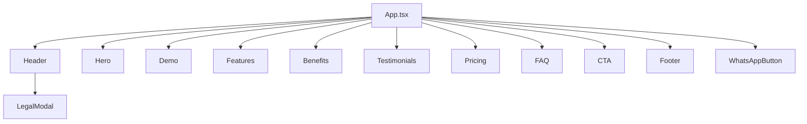

<div align="center">

# 💬 Aivy

**Your personal secretary, right inside WhatsApp.**

An AI assistant that understands natural language to schedule appointments and send smart reminders.

<br />

[](https://react.dev)
[](https://www.typescriptlang.org)
[](https://tailwindcss.com)
[](https://vitejs.dev)

<br />

[About](#-about) · [Features](#-features) · [Tech stack](#-tech-stack) · [Architecture](#-architecture) · [Use cases](#-use-cases) · [Roadmap](#-roadmap) · [Quick start](#-quick-start)

</div>

<br />

## ◆ About

**Aivy** turns WhatsApp into a complete scheduling and productivity tool. Just send a message, and the AI understands what you mean, creates the appointment, and reminds you at the right time.

This repository holds the **landing page** that presents the product: its value, features, pricing, and an interactive chat demo.

| | |
|---|---|
| 📅 | Schedule with natural language |
| 🔔 | Automatic smart reminders |
| 🤖 | AI that understands context |
| ⚡ | No forms, no complex interfaces |
| 📱 | Everything happens in WhatsApp |

<br />

## ◆ Features

| | Feature | What it delivers |
|:-:|---|---|
| 💬 | **Natural language scheduling** | Date, time, and details extracted from plain text, with easy editing and cancelling |
| 🔔 | **Multi-level reminders** | Alerts 1 day, 1 hour, and 15 minutes before, with customizable intervals |
| 🧠 | **AI intelligence** | Intent recognition, smart time suggestions, and learning from your habits |
| 🛠️ | **Productivity tools** | Calendar export (Google Calendar, Outlook), agenda view, search, categories, and analytics |

**Example commands**

```
"Schedule meeting for tomorrow at 2pm"
"Remind me to call client at 3pm"
"Cancel my meeting tomorrow"
"Show my schedule for the week"
"Reschedule Friday's appointment to Monday"
```

<br />

## ◆ Tech stack

| Category | Technology | Purpose |
|---|---|---|
| **Framework** | React 18.3 | UI library with hooks and components |
| **Language** | TypeScript 5.5 | Type safety and better developer experience |
| **Styling** | Tailwind CSS 3.4 | Utility-first styling |
| **Build tool** | Vite 5.4 | Fast dev server and bundler |
| **CSS processing** | PostCSS | CSS transformations |
| **Code quality** | ESLint | Linting and code standards |

<br />

## ◆ Architecture



```
aivy/
├── src/
│   ├── App.tsx                 Main application
│   ├── main.tsx                Entry point
│   ├── index.css               Global styles
│   └── components/
│       ├── Header.tsx          Navigation bar
│       ├── Hero.tsx            Value proposition
│       ├── Demo.tsx            Interactive chat demo
│       ├── Features.tsx        Feature showcase
│       ├── Benefits.tsx        Value propositions
│       ├── Testimonials.tsx    Social proof
│       ├── Pricing.tsx         Pricing plans
│       ├── FAQ.tsx             Frequently asked questions
│       ├── CTA.tsx             Call to action
│       ├── Footer.tsx          Footer with links
│       ├── WhatsAppButton.tsx  Floating WhatsApp button
│       ├── LegalModal.tsx      Terms and privacy modal
│       └── common/
│           ├── Button.tsx      Reusable button
│           └── FeatureCard.tsx Reusable feature card
├── index.html
├── vite.config.ts
├── tailwind.config.js
├── tsconfig.json
└── package.json
```

<br />

## ◆ Landing page sections

| Section | Purpose |
|---|---|
| **Hero** | Headline, value proposition, CTA buttons, and a WhatsApp interface mockup |
| **Demo** | Chat simulation with example commands and AI-style responses |
| **Features** | Grid of the main features, with icon, title, and description |
| **Benefits** | Problem and solution format with clear outcomes |
| **Testimonials** | Customer quotes and social proof |
| **Pricing** | Transparent plans with feature comparison and a highlighted popular plan |
| **FAQ** | Answers to the most common questions |
| **CTA** | Final call to action |

**Reusable components**

| Component | Highlights |
|---|---|
| **Button** | Primary, secondary, and outline variants, three sizes, loading state, icon support, typed props |
| **FeatureCard** | Consistent card design with icon, title, description, and hover animation |

<br />

## ◆ Use cases

| | Audience | How Aivy helps |
|:-:|---|---|
| 👔 | **Professionals** | Manage client meetings, deadlines, and appointments |
| 💼 | **Entrepreneurs** | Stay organized without hiring an assistant |
| 👥 | **Teams** | Coordinate schedules and never miss a sync |
| 🏥 | **Healthcare** | Patient appointments and medication reminders |
| 🎓 | **Students** | Track classes, assignments, and study sessions |
| 🏠 | **Personal use** | Family events, bills, and daily tasks |

<br />

## ◆ Roadmap

**Product roadmap**

- [x] **Phase 1, Core:** natural language scheduling, smart reminders, basic AI understanding, WhatsApp integration, agenda management
- [ ] **Phase 2, Integrations:** Google Calendar, Outlook, Zoom, Google Meet, Slack notifications
- [ ] **Phase 3, Advanced:** multi-user scheduling, team calendars, recurring appointments, time zones, voice commands
- [ ] **Phase 4, Premium:** AI meeting summaries, smart scheduling suggestions, priority management, advanced analytics, custom workflows

<br />

## ◆ Design system

| Color | Hex | Usage |
|---|---|---|
| **WhatsApp Green** | `#25D366` | Primary brand color |
| **Dark Green** | `#128C7E` | Hover states |
| **Light Green** | `#DCF8C6` | Message bubbles |
| **Dark Gray** | `#1F2937` | Text and backgrounds |
| **Light Gray** | `#F3F4F6` | Backgrounds |

**Typography:** system fonts with bold weights for headings, Inter for body text, and monospace for technical content.

<br />

## ◆ Quick start

```bash
git clone https://github.com/joaogalimberti/aivy.git
cd aivy
npm install
npm run dev
```

Open **http://localhost:5173**.

| Command | Description |
|---|---|
| `npm run dev` | Starts the dev server |
| `npm run build` | Builds for production |
| `npm run preview` | Previews the production build |
| `npm run lint` | Runs ESLint |

<br />

<div align="center">

[](mailto:joaogalimberti@gmail.com)
[](https://www.linkedin.com/in/joaogalimberti/)
[](https://github.com/joaogalimberti)

<br />

*Transforming WhatsApp into your productivity powerhouse.*

</div>
